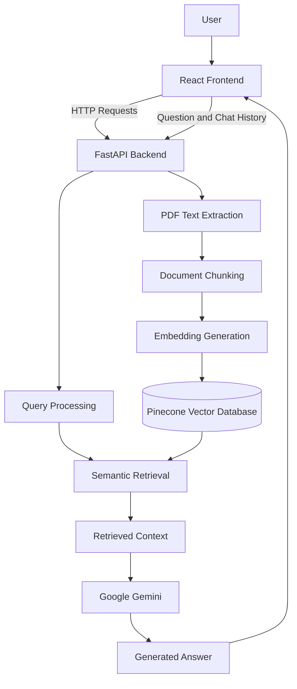

# RAG-PDF-Chatbot
### Full-Stack RAG-Based PDF Question Answering System

<p align="center">
  
  
  
  
  
  
  
</p>

<p align="center">
  A full-stack AI-powered document assistant for PDF upload, semantic retrieval, and context-aware question answering using Retrieval-Augmented Generation (RAG).
</p>

---

## Table of Contents

- [Overview](#overview)
- [Problem Statement](#problem-statement)
- [System Architecture](#system-architecture)
- [Key Features](#key-features)
- [Tech Stack](#tech-stack)
- [Project Structure](#project-structure)
- [Getting Started](#getting-started)
  - [1. Prerequisites](#1-prerequisites)
  - [2. Backend Setup](#2-backend-setup)
  - [3. Frontend Setup](#3-frontend-setup)
- [How It Works](#how-it-works)
- [API Reference](#api-reference)
- [Configuration](#configuration)
- [Future Roadmap](#future-roadmap)
- [Author](#author)
- [Acknowledgements](#acknowledgements)
- [License](#license)

---

## Overview

**ARAG-PDF-Chatbot** is a full-stack Retrieval-Augmented Generation (RAG) application that allows users to interact with PDF documents through natural-language questions.

The application combines document processing, vector search, and large language models to retrieve relevant information and generate answers grounded in document content.

The frontend is built with React and Vite, while the backend uses FastAPI, LangChain, Google Gemini, and Pinecone to support the document question-answering workflow.

### Objectives

- Simplify information retrieval from lengthy PDF documents.
- Enable users to ask questions in natural language.
- Retrieve relevant document passages through semantic search.
- Generate context-aware answers using an LLM.
- Integrate AI services into a modular full-stack web application.

## Problem Statement

Extracting specific information from lengthy PDF documents can be time-consuming. Conventional keyword searches may also miss relevant passages when the wording of a question differs from the wording in the source document.

This project addresses the challenge by combining semantic retrieval with generative AI, enabling users to query document content through an interactive web interface.

---

## System Architecture

The application follows a frontend-backend architecture connected to a RAG pipeline.



### Architecture Components

| Component | Responsibility |
|---|---|
| React + Vite | User interface and frontend development |
| FastAPI | Backend API and request handling |
| `main.py` | Main API application |
| `chat.py` | Chat-related processing |
| `rag_engine.py` | RAG and retrieval logic |
| LangChain | RAG framework and integrations |
| Google Gemini | AI model and embedding services |
| Pinecone | Vector storage and similarity retrieval |

## Key Features

- **PDF Upload:** Upload PDF documents through the web interface.
- **Document Question Answering:** Ask natural-language questions about document content.
- **Retrieval-Augmented Generation:** Retrieve relevant context before generating responses.
- **Semantic Search:** Retrieve information based on query meaning.
- **AI-Powered Responses:** Integrate Google Gemini into the question-answering workflow.
- **Vector Database:** Use Pinecone for document vector storage and retrieval.
- **Interactive Chat Interface:** Present questions and answers in a React-based interface.
- **Modular Backend:** Separate API handling, chat functionality, and RAG logic.
- **API-Based Integration:** Connect the frontend and backend using HTTP requests.

---

## Tech Stack

| Component | Technology | Role |
|---|---|---|
| Frontend | React 18 | Interactive user interface |
| Frontend Tooling | Vite 5 | Development server and build tooling |
| HTTP Client | Axios | Frontend API communication |
| Backend | Python, FastAPI | API and application logic |
| ASGI Server | Uvicorn | Backend execution |
| RAG Framework | LangChain | Retrieval workflow components |
| Language Model | Google Gemini | AI response generation |
| Embedding Service | Gemini Embedding API | Text vector generation |
| Vector Database | Pinecone | Vector storage and retrieval |
| PDF Processing | pypdf | PDF text extraction |

---

## Project Structure

```text
AI-Document-Intelligence/
│
├── assets/
│   ├── Homepage.png
│   └── chat_response.png
│
├── backend/
│   ├── main.py
│   ├── chat.py
│   ├── rag_engine.py
│   ├── requirements.txt
│   └── .env.example
│
├── frontend/
│   ├── src/
│   │   ├── components/
│   │   │   ├── Message.jsx
│   │   │   └── Sidebar.jsx
│   │   ├── api.js
│   │   ├── App.jsx
│   │   ├── index.css
│   │   └── main.jsx
│   ├── index.html
│   ├── package.json
│   ├── package-lock.json
│   └── vite.config.js
│
├── .gitignore
├── LICENSE
└── README.md
```

---

## Getting Started

Follow these instructions to run the application locally.

### 1. Prerequisites

Install the following:

- Python compatible with the pinned backend dependencies
- Node.js and npm
- Google Gemini API key
- Pinecone API key and an appropriately configured index
- Git

### 2. Backend Setup

Navigate to the project directory and open the backend folder:

**Linux / macOS**

```bash
cd ~/Projects/rag-pdf-chatbot/backend
python3 -m venv venv
source venv/bin/activate
```

**Windows PowerShell**

```powershell
cd backend
python -m venv venv
.\venv\Scripts\Activate.ps1
```

Install the backend dependencies:

```bash
python -m pip install -r requirements.txt
```

Create your local environment configuration file.

**Linux / macOS**

```bash
cp .env.example .env
```

**Windows PowerShell**

```powershell
Copy-Item .env.example .env
```

Configure the required API credentials as described in the Configuration section.

Start the backend server:

```bash
uvicorn main:app --reload --port 8000
```

The backend should be accessible at:

`http://localhost:8000`

Test the health endpoint:

`http://localhost:8000/health`

FastAPI interactive documentation is available at:

`http://localhost:8000/docs`

### 3. Frontend Setup

Open a second terminal.

**Linux / macOS**

```bash
cd ~/Projects/rag-pdf-chatbot/frontend
npm install
npm run dev
```

**Windows PowerShell**

```powershell
cd frontend
npm install
npm run dev
```

Vite will print the local development URL. It is commonly:

`http://localhost:5173`

Keep both the frontend and backend running while using the application.

The frontend API client currently points to `http://localhost:8000`. If you change the backend address or port, update `frontend/src/api.js` accordingly.

---

## How It Works

1. **PDF Upload:** The user selects a PDF file through the frontend.
2. **Text Extraction:** The backend extracts text from the uploaded document.
3. **Document Preparation:** The extracted content is prepared for retrieval.
4. **Embedding Generation:** Text is represented as numerical vectors.
5. **Vector Indexing:** Document vectors are stored in Pinecone.
6. **Question Submission:** The user submits a question and optional chat history.
7. **Semantic Retrieval:** Relevant document information is retrieved.
8. **Answer Generation:** The AI model uses the retrieved context to generate a response.
9. **Response Display:** The answer is returned to the frontend and displayed to the user.

---

## API Reference

The backend exposes HTTP endpoints through FastAPI for health checks, document uploads, and question answering.

### Health Check

- **Endpoint:** `GET /health`
- **Purpose:** Check backend availability.
- **Test URL:** `http://localhost:8000/health`

Use the response defined in `backend/main.py` to verify that the service is running.

### PDF Upload

- **Endpoint:** `POST /upload`
- **Content-Type:** `multipart/form-data`
- **Request field:** `file`
- **Purpose:** Upload a PDF for document processing.

Example using cURL:

```bash
curl -X POST "http://localhost:8000/upload" \
  -F "file=@document.pdf"
```

Replace `document.pdf` with the path to your PDF file.

The response format and processing behavior are defined by the backend implementation.

### Document Question Answering

- **Endpoint:** `POST /query`
- **Content-Type:** `application/json`
- **Purpose:** Submit a question and optional chat history.

Example request body:

```json
{
  "question": "What are the main points in this document?",
  "chat_history": []
}
```

Example cURL request:

```bash
curl -X POST "http://localhost:8000/query" \
  -H "Content-Type: application/json" \
  -d '{"question":"What are the main points in this document?","chat_history":[]}'
```

The exact response fields are defined by the backend's `QueryResponse` schema.

### Interactive API Documentation

Start the backend and open:

`http://localhost:8000/docs`

The Swagger interface allows you to inspect endpoint parameters, request schemas, response formats, and supported status codes.

---

## Configuration

The backend includes an `.env.example` file containing the required environment variable names.

### Backend (`backend/.env`)

```env
GEMINI_API_KEY=your_gemini_api_key_here
PINECONE_API_KEY=your_pinecone_api_key_here
PINECONE_INDEX_NAME=doc-chatbot
```

These values are placeholders. Add your own credentials to the local `.env` file.

### Frontend API Configuration

The frontend API client is configured in:

`frontend/src/api.js`

The current backend base URL is:

```text
http://localhost:8000
```

Ensure the backend is accessible at this address while running the frontend locally.

**Security considerations:**

- Never commit real API keys to GitHub.
- Keep `.env` files excluded from version control.
- Use your own API credentials and vector database resources.
- Review how uploaded documents are processed and transmitted to external services.

---

## Future Roadmap

- [ ] Support for additional document formats.
- [ ] Improved retrieval with hybrid search and reranking.
- [ ] Source references and page-level citations.
- [ ] Persistent conversation history.
- [ ] User authentication and document access controls.
- [ ] Retrieval and answer-quality evaluation.
- [ ] Docker-based deployment and CI/CD integration.

These are potential enhancements and should not be interpreted as features already implemented.

---

## Author

**Syed Yellanoor Afreen**

- **GitHub:** [@YOUR-GITHUB-USERNAME](https://github.com/YOUR-GITHUB-USERNAME)
- **Repository:** [AI-Document-Intelligence](https://github.com/YOUR-GITHUB-USERNAME/AI-Document-Intelligence)

Replace `YOUR-GITHUB-USERNAME` with your actual GitHub username and verify the repository URL after creating your repository.

## Acknowledgements

This project uses open-source frameworks and external AI services, including React, FastAPI, LangChain, Google Gemini, and Pinecone.

Original project reference:

[RAG PDF Chatbot](https://github.com/ritwik-basak/rag-pdf-chatbot)

The original implementation and its applicable license and attribution requirements should be preserved when modifying or redistributing the code.

## License

See the included [LICENSE](LICENSE) file for the applicable license terms. Preserve the original license and required attribution when redistributing the project.
